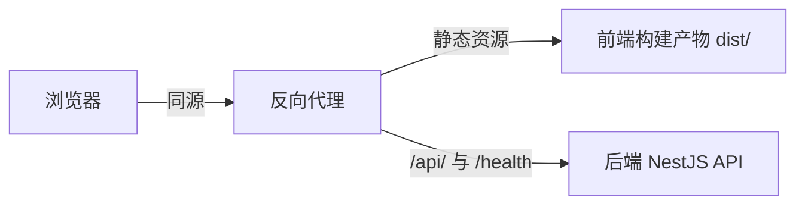

# 前端架构

状态：F1.1/F1.2已建立装配、布局、路由及输入守卫、共享HTTP/上传/SSE基础、通用状态与健康检查；业务页面仍为占位。下文任务轮询、业务接口和认证由后续阶段交付。技术选型依据见[ADR-0001](decisions/0001-frontend-stack.md)，接口对接见[API对接](api-integration.md)，页面与展示规则见[界面规范](ui-guidelines.md)。

## 1. 职责边界

前端负责：

- 展示后端返回的数据，收集用户输入并调用接口。
- 客户端输入预检（只为提前提示，后端始终重新校验）。
- 任务进度的轮询或SSE订阅、断线恢复后的重新获取。

前端不负责：

- 计算、取整、排序或补全任何分数、排名、覆盖率和资格判断。这些全部来自后端。
- 推断证据或把缺失数据显示为某个等级。
- 持有任何密钥或模型服务地址。前端只访问本站的 `/api/v1` 与 `/health`。

## 2. 运行拓扑



- 生产同源部署，浏览器不跨域，后端不开CORS。见[部署](deployment.md)。
- 本地开发由Vite开发服务器代理 `/api` 与 `/health` 到 `http://127.0.0.1:3000`。
- 接口基础路径固定为相对路径 `/api/v1`，不通过环境变量配置后端地址。

## 3. 目录结构

```text
Resume-Studio-Frontend/
  AGENTS.md
  README.md
  CONTRIBUTING.md
  docs/
  contracts/
    openapi.json          # 后端OpenAPI产物快照，记录来源提交（提交到仓库）
    SOURCE.md             # 快照对应的后端提交SHA与生成日期
  public/
  src/
    main.ts               # 只调用 app/ 中的创建函数
    app/                  # 应用装配：插件、路由、全局错误处理、布局
      App.vue
      router/             # 路由表与守卫
      providers/          # Vue Query、Pinia、Element Plus 的安装
      layouts/
      styles/             # 全局样式与设计变量 tokens.css
    pages/                # 路由级页面：组合feature组件，不写业务逻辑
    features/             # 业务功能，每个子目录对应一个业务领域
      resumes/
      jobs/
      analyses/
      tasks/
      reports/
      system/             # 健康检查等
    shared/               # 与业务无关的通用代码
      api/                # HTTP客户端核心、错误标准化、上传、SSE
      ui/                 # 通用展示组件（不调用接口）
      lib/                # 纯函数工具（格式化、时间、ID）
      config/             # 编译期配置读取与校验
    generated/            # OpenAPI生成的类型与Zod Schema（不提交，构建前生成）
  tests/
    e2e/                  # Playwright
    mocks/                # MSW handlers 与夹具
```

每个feature目录内部结构：

```text
features/<领域>/
  index.ts        # 对外公开的组件、composable与类型；其他目录只能从这里导入
  api/            # 该领域的查询与变更composable（封装Vue Query与客户端调用）
  model/          # 领域类型、Zod Schema的二次约束、响应到视图模型的映射
  components/     # 该领域的组件
  composables/    # 不直接调用接口的交互逻辑
```

## 4. 依赖方向

`app → pages → features → shared`，`generated` 只能被 `shared/api` 与 `features/*/api`、`features/*/model` 导入。

- `shared` 不导入 `features`、`pages` 或 `app`。
- 一个feature只能通过另一个feature的 `index.ts` 使用它，不导入其内部文件；出现双向依赖时把共同部分下沉到 `shared` 或新建feature。
- 组件不直接调用 `fetch`，统一通过 `features/*/api` 中的composable。
- 以上规则在F1.1用ESLint `no-restricted-imports`（或等效规则）强制执行。

## 5. 状态管理

| 状态类型 | 存放位置 | 例子 |
|---|---|---|
| 服务端数据 | Vue Query缓存 | 简历列表、任务状态、报告 |
| 跨页面的客户端状态 | Pinia store | 当前用户、侧边栏折叠 |
| 页面内临时状态 | 组件 `ref`/`reactive` | 表单输入、弹窗开关 |
| 可分享的视图状态 | URL查询参数 | 列表筛选、报告当前标签页 |

- Query key 统一定义在各feature的 `api/keys.ts`，形如 `['tasks', taskId]`，不在组件内手写字符串。
- 变更成功后按key精确失效相关查询，不调用全量失效。
- 不在localStorage、sessionStorage或IndexedDB中保存简历内容、报告、证据或任何凭证。界面偏好可以保存。

## 6. 路由

| 路径 | 页面 | 依赖后端阶段 |
|---|---|---|
| `/` | 重定向到 `/resumes` | — |
| `/resumes` | 简历列表与上传 | S2.1 |
| `/resumes/:resumeId` | 简历版本详情与解析文本块 | S2.1 |
| `/jobs` | 岗位列表与索引状态 | S2.2 |
| `/jobs/new`、`/jobs/:jobId` | 新建JD、结构化要求确认与发布 | S2.2 |
| `/analyses/new` | 选择简历版本与岗位范围并发起分析 | S2.4 |
| `/tasks/:taskId` | 任务进度、重试与取消 | S1.4 |
| `/reports` | 报告历史 | S3.1 |
| `/reports/:reportId` | 报告详情：画像、推荐、待核实、差距、调权重算 | S3.1 |
| `/login` | 登录 | S3.2 |
| `/:pathMatch(.*)*` | 404页面 | — |

- 页面组件用路由级懒加载（`() => import(...)`）。
- 路由参数在页面入口用Zod校验，非法参数显示404，不发请求。
- 登录在S3.2之前不存在；路由守卫预留统一入口 `app/router/guards.ts`，开发期始终放行。S3.2后收到401时跳转 `/login?redirect=<原路径>`，`redirect` 只接受站内相对路径。

## 7. 错误处理

- `shared/api` 把所有失败标准化为 `AppError`：`{ kind, code, message, retryable, requestId?, status? }`。`kind` 区分 `http`（后端错误体）、`network`（无响应）、`contract`（响应未通过Zod校验）、`aborted`。
- 展示文案使用后端 `message`；网络与契约错误使用前端固定文案。任何错误界面都显示可复制的requestId（若存在）。
- 只对 `retryable: true` 与网络错误自动重试，最多2次，指数退避；变更请求（POST等）只在携带Idempotency-Key时才自动重试。
- 全局 `app.config.errorHandler` 与 `window` 未处理的Promise拒绝统一进入错误上报函数。首版只输出到开发控制台；生产错误监控需单独决策（FD2），不得上报简历内容或证据原文。

F1.2实现：HTTP层承担最多两次重试，Vue Query关闭同一请求的额外重试；超时为network/TIMEOUT，主动取消为aborted。错误组件复制requestId失败时保留可选择文本。FD2已确定首版不引入生产监控，开发日志仅kind/requestId，不输出message/原异常/组件上下文；生产不输出或发送错误。

## 8. 任务进度

- 默认轮询 `GET /api/v1/tasks/:taskId`，间隔2秒；任务到达终态（`SUCCEEDED`、`PARTIAL`、`FAILED`、`CANCELLED`）后停止；页面不可见时暂停。
- S3.1提供SSE后改为订阅 `/api/v1/tasks/:taskId/events`。浏览器原生EventSource重连时会自动携带 `Last-Event-ID`；SSE断开超过重试上限时回退到轮询。
- 进度只显示后端给出的阶段和计数，不做时间估算或等速动画。

## 9. 安全

- 禁止用 `v-html` 渲染接口数据、用户输入或URL参数。简历原文、证据quote、JD正文一律按纯文本插值。
- 外链只来自后端明确的URL字段，使用 `rel="noopener noreferrer"`；不根据用户输入拼接 `javascript:` 等协议。
- 只有 `VITE_` 前缀的环境变量会进入构建产物，其中不得包含任何秘密。
- 生产构建不公开发布sourcemap。
- 认证采用后端会话Cookie（决策D9），前端不读取或保存令牌。
- 安全响应头与CSP由反向代理设置，见[部署](deployment.md#3-安全响应头)。

## 10. 性能与可访问性

- 路由级代码分割；ECharts从 `echarts/core` 按需注册所用图表与组件。
- 长列表使用分页（后端游标分页），不一次加载全部。
- 初始目标：首屏JS（gzip）不超过300 KB。这是待测量的起点，F3.2用构建分析确认后再定为约束。
- 可访问性目标为WCAG 2.2 AA：可键盘操作、表单有可见标签、颜色不是唯一的信息来源、图表提供等价的表格或文字。
- 首版面向桌面端，宽度1280px及以上为主要设计尺寸，768px以上可正常使用；手机端不作为首版目标。
